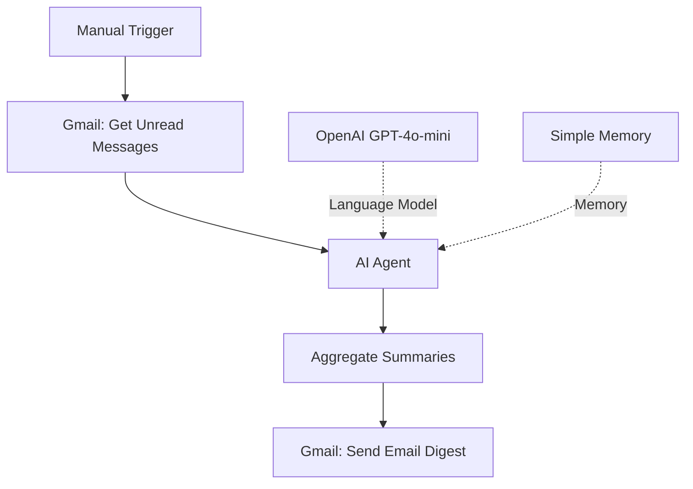

# Gmail AI Agent – AI-Powered Email Summarization


## Overview

Gmail AI Agent is an AI-powered email automation workflow built using n8n, Gmail and OpenAI. It retrieves up to five unread emails, generates a concise one-line summary for each email, and sends a consolidated email digest to a configured recipient.

The project demonstrates how generative AI and workflow automation can reduce the time spent reviewing unread emails.

## Features

- Retrieve up to five unread Gmail messages per execution.
- Summarize emails using OpenAI GPT-4o-mini.
- Request summaries of no more than 20 words per email.
- Configure Simple Memory using the email message ID as the session key.
- Aggregate individual summaries into a single plain-text email digest.
- Send the digest through Gmail using OAuth 2.0 authentication.
- Execute the workflow manually from the n8n editor.

## Workflow Architecture



## Technology Stack

| Technology | Purpose |
| --- | --- |
| n8n | Workflow orchestration and automation |
| Gmail API | Retrieve unread messages and send email digests |
| OpenAI GPT-4o-mini | AI-powered email summarization |
| Simple Memory | Message-specific conversational context |
| OAuth 2.0 | Gmail authentication |
| JSON | Portable n8n workflow configuration |

## How It Works

| Step | Node | Description |
| --- | --- | --- |
| 1 | Manual Trigger | Starts the workflow when Execute Workflow is clicked. |
| 2 | Get many messages | Retrieves up to five unread Gmail messages. |
| 3 | AI Agent | Generates a short summary from the sender, subject and email snippet. |
| 4 | OpenAI Chat Model | Provides the GPT-4o-mini language model to the agent. |
| 5 | Simple Memory | Uses the Gmail message ID as the session key. |
| 6 | Aggregate | Collects the individual `output` fields into an array. |
| 7 | Send a message | Joins the summaries with blank lines and sends the consolidated digest. |

## AI Prompt

The AI Agent uses the following prompt:

```text
Write ONE line (20 words maximum) describing this email.
No greeting, no heading, no extra text.
From: {{ $json.From }}  Subject: {{ $json.Subject }}
Preview: {{ $json.snippet }}
```

The agent processes email previews rather than full message bodies or attachments. The word limit is a prompt instruction, not a programmatically enforced validation rule.

## Getting Started

### Prerequisites

- A running n8n instance (cloud or self-hosted).
- A Gmail account with Gmail OAuth 2.0 credentials configured in n8n.
- An OpenAI API key with access to GPT-4o-mini and available API credits.

### Installation and Configuration

1. Download `Gmail AI Agent.json` from this repository.
2. Open n8n and create a new workflow.
3. Select **Import from File** and choose the downloaded JSON file.
4. Open the **Get many messages** node and select your Gmail OAuth 2.0 credential.
5. Open the **OpenAI Chat Model** node, select your OpenAI credential and confirm the model is `gpt-4o-mini`.
6. Open the **Send a message** node, select your Gmail credential and replace the recipient with your own email address.
7. Save the workflow and click **Execute Workflow** to test it.

## Sample Output

Illustrative email digest (not an actual execution result):

**Subject:** Latest Unread Mail Summaries

```text
The project manager requests an update on the current sprint before Friday.

HR has shared details about the upcoming employee training session.

GitHub reports a new pull request requiring code review.

The finance team has sent a reminder about expense submission.

A meeting invitation has been received for the upcoming project discussion.
```

## Repository Structure

```text
.
├── Gmail AI Agent.json    # Importable n8n workflow
└── README.md              # Project documentation
```

## Security and Privacy

- Never commit API keys, OAuth tokens or client secrets to GitHub.
- Remove personal recipient addresses, credential references and instance-specific metadata from exported workflows before publishing.
- Configure your own credentials after importing the workflow.
- Email sender, subject and preview data are transmitted to OpenAI for summarization. Use only accounts and data you are authorized to process.
- Treat email content as untrusted input; review generated summaries before relying on them.

## Current Limitations

- The workflow uses a manual trigger; it does not run on a schedule.
- Only up to five unread messages are processed per execution.
- Messages are not explicitly marked as read, so subsequent runs may summarize the same emails.
- There is no dedicated empty-inbox handling, retry logic or summary validation in the exported workflow.
- AI-generated summaries may omit details or contain inaccuracies.

## Future Enhancements

- Add a Schedule Trigger for daily email digests.
- Classify emails by priority and category.
- Extract action items and deadlines.
- Prevent duplicate summaries using processed message IDs.
- Add error handling, retries and empty-inbox handling.
- Deliver summaries through Slack or Telegram.

## Resources

- [n8n Documentation](https://docs.n8n.io/)
- [Gmail API Documentation](https://developers.google.com/gmail/api)
- [OpenAI API Documentation](https://platform.openai.com/docs/)
